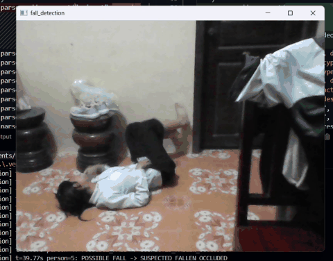
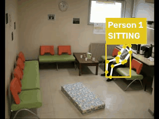
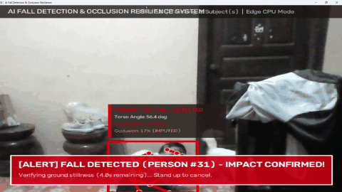

# 🛡️ Dual-Model Fall Detection & Activity Recognition Suite

**Owner / Author:** chanreachouch1 (chanreach.ouch@gmail.com)  
**Project Workspace:** Fall Detection Suite  

An enterprise-ready computer vision engineering workspace hosting two state-of-the-art pose estimation fall detection architectures sharing a unified Python virtual environment and shared model repository.

---

## 🎥 Live System Demos & Visual Results

Visual demonstrations of real-time pose estimation, activity recognition, occlusion resilience, and fall detection across varied camera perspectives.

### 1. YOLO26 Pose: Activity Recognition & Fall Verification
*Multi-stage temporal state machine tracking human posture transitions (`WALKING -> POSSIBLE_FALL -> FALLEN`) with 6-factor telemetry scoring:*

<div align="center">
  
  <p><em>Real-time skeleton tracking, posture geometry classification, and immediate FALL trigger.</em></p>
  <p>🎬 <strong>Full Video:</strong> <a href="demo/demo%20fall%20detection%20yolo26.mp4"><code>demo/demo fall detection yolo26.mp4</code></a> (864x678 @ 30 FPS)</p>
</div>

---

### 2. CCTV Surveillance Fall Detection (Low-Resolution Stream)
*Testing real-time robustness under low-resolution, high-noise surveillance camera conditions:*

<div align="center">
  
  <p><em>Continuous monitoring and fall trigger on a 320x240 CCTV camera stream.</em></p>
  <p>🎬 <strong>Full Video:</strong> <a href="demo/cctv%20testing%20fall%20detection%20yolo26.mp4"><code>demo/cctv testing fall detection yolo26.mp4</code></a> (320x240 @ 25 FPS)</p>
</div>

---

### 3. YOLOv8 Pose: Occlusion Resilience & Kinematics
*High-resolution elderly fall detection featuring bone length ratio imputation and false-positive sleeping rejection:*

<div align="center">
  
  <p><em>17 COCO keypoint estimation, velocity extrapolation, and telemetry HUD visualizer.</em></p>
  <p>🎬 <strong>Full Video:</strong> <a href="demo/demo%20fall%20detection%20yolo8n.mp4"><code>demo/demo fall detection yolo8n.mp4</code></a> (1920x1080 @ 30 FPS)</p>
</div>

---

## 📁 Workspace Architecture

```
Fall Detection/
│
├── .venv/                              # Shared Python 3.12 Virtual Environment
├── demo/                               # Demo recordings, animated GIFs & preview posters
│   ├── demo_yolo26.gif                 # Animated GIF: YOLO26 pipeline
│   ├── demo_cctv_yolo26.gif            # Animated GIF: CCTV stream test
│   ├── demo_yolo8.gif                  # Animated GIF: YOLOv8 pipeline
│   ├── demo fall detection yolo26.mp4  # Full HD demo video
│   ├── demo fall detection yolo8n.mp4  # Full HD demo video
│   └── cctv testing fall detection.mp4 # Full CCTV video
│
├── models/                             # Shared Pose Weights Repository
│   ├── yolov8n-pose.pt                 # YOLOv8 Nano Pose (6.5 MB - ultra fast)
│   ├── yolov8s-pose.pt                 # YOLOv8 Small Pose (23.5 MB)
│   ├── yolov8m-pose.pt                 # YOLOv8 Medium Pose (53.2 MB - high accuracy)
│   ├── yolo11n-pose.pt                 # YOLO11 Nano Pose (6.2 MB)
│   └── yolo26s-pose.pt                 # YOLO26 Small Pose (24.1 MB - NMS-free)
│
├── yolov8-pose-fall-detection/         # Project 1: Occlusion Resilience & Kinematics
│   ├── core/
│   │   ├── detector.py                 # Pose detector module
│   │   ├── kinematics.py               # Biomechanical velocity & angle analysis
│   │   ├── occlusion.py                # Bone ratio imputation & furniture ROI tracking
│   │   ├── state_machine.py            # False-alarm rejection (resting vs. falling)
│   │   ├── tracker.py                  # Multi-person tracker
│   │   └── visualizer.py               # HUD telemetry visualizer
│   ├── models/                         # Local weights (yolov8m-pose.pt, yolov8n-pose.pt)
│   ├── sample_videos/                  # Benchmark clips
│   ├── main.py                         # CLI execution pipeline
│   ├── run.py                          # Interactive runner (Webcam, Custom Video, Synthetic Demo)
│   └── run.bat                         # Quick launcher
│
├── yolo26-pose-fall-detection/         # Project 2: Human Activity Recognition (HAR)
│   ├── src/
│   │   ├── activity_classifier.py      # Geometry posture classifier (STAND, SIT, WALK)
│   │   ├── fall_detector.py            # 6-Factor fall scoring state machine
│   │   ├── pose_detector.py            # Ultralytics pose wrapper
│   │   ├── tracker.py                  # Tracklet history & deduplication
│   │   └── visualization.py            # High-visibility HUD & skeleton drawing
│   ├── models/
│   │   └── yolo26s-pose.pt             # Default model weights
│   ├── input/                          # Test videos (video_1.avi - video_4.avi)
│   ├── output/                         # Annotated output videos & event JSON/CSVs
│   ├── tests/                          # Automated unit test suite
│   ├── tools/                          # CVAT to YOLO-pose dataset converter
│   └── fall_detection.py               # CLI execution pipeline
│
├── run_yolov8.bat                      # One-click launcher for Project 1
├── run_yolo26.bat                      # One-click launcher for Project 2
├── requirements.txt                    # Workspace-wide pinned requirements
└── README.md                           # Master documentation
```

---

## ⚡ Quickstart

### 1. Activate the Shared Virtual Environment

In PowerShell:
```powershell
.\.venv\Scripts\Activate.ps1
```
Or in Command Prompt:
```cmd
.venv\Scripts\activate.bat
```

---

## 🚀 Running the Projects

### Project 1: YOLOv8 Pose Fall Detection (`yolov8-pose-fall-detection`)

Specialized in **occlusion resilience** (falls behind furniture/tables) and **eliminating false alarms** from intentional bed resting or sleeping.

* **Interactive Mode (Recommended):**
  ```powershell
  cd yolov8-pose-fall-detection
  ..\.venv\Scripts\python.exe run.py
  ```
  *(Or double-click `run_yolov8.bat` at the root)*

* **CLI Pipeline with YOLOv8 Medium (High Accuracy):**
  ```powershell
  cd yolov8-pose-fall-detection
  ..\.venv\Scripts\python.exe main.py --model models/yolov8m-pose.pt --source demo --save output_demo.mp4
  ```

* **Live Webcam Monitoring:**
  ```powershell
  cd yolov8-pose-fall-detection
  ..\.venv\Scripts\python.exe main.py --source 0 --show
  ```

---

### Project 2: YOLO26 Pose Fall Detection & Activity Recognition (`yolo26-pose-fall-detection`)

Specialized in **Human Activity Recognition** (`STANDING`, `SITTING`, `WALKING`, `FALLING`, `FALLEN`) using a 6-factor temporal scoring machine with depth-axis fall detection.

* **Run on Benchmark Video:**
  ```powershell
  cd yolo26-pose-fall-detection
  ..\.venv\Scripts\python.exe fall_detection.py --model models/yolo26s-pose.pt --input input/video_2.avi --output output/result_video_2.mp4
  ```
  *(Or double-click `run_yolo26.bat` at the root)*

* **With Real-Time OpenCV Preview & Telemetry Overlay:**
  ```powershell
  cd yolo26-pose-fall-detection
  ..\.venv\Scripts\python.exe fall_detection.py --input input/video_1.avi --output output/result_1.mp4 --show --debug
  ```

* **Run Automated Unit Tests:**
  ```powershell
  cd yolo26-pose-fall-detection
  ..\.venv\Scripts\python.exe -m unittest discover tests
  ```

---

## 🔄 Model Interchangeability

Because both codebases use the **COCO 17-keypoint topology** via Ultralytics:
* You can run `yolo26-pose-fall-detection` with any model from `../models/` (e.g. `--model ../models/yolov8m-pose.pt`).
* You can run `yolov8-pose-fall-detection` with any model from `../models/` (e.g. `--model ../models/yolo26s-pose.pt`).

